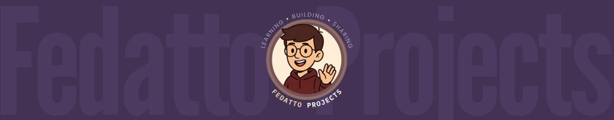

  

  # Victor Hugo Fedatto

  **Computer Science & Law Student · Software Development · Product Design**

  Building practical digital products at the intersection of technology, design, and real-world problems.

  [LinkedIn](https://www.linkedin.com/in/victor-hugo-fedatto/) · [GitHub](https://github.com/vhfedatto) · [Dribbble](https://dribbble.com/vhfedatto)

---

### About me

I'm a Brazilian developer studying **Computer Science at UNIESP** and **Law at FICV**. I work across frontend and backend development, with a particular interest in software architecture, cybersecurity, user experience, and technical documentation.

I enjoy turning complex workflows into accessible products — from fitness management and personal finance to legal technology. My background in Law also informs how I approach privacy, compliance, and software requirements.

### Selected projects

| Project | What it does | Focus |
| --- | --- | --- |
| **[StepUp](https://github.com/vhfedatto/pjt-Stepup)** | Platform for trainers to manage athletes, training plans, and progress tracking. | React, TypeScript, testing, product development |
| **TechJur** *(academic project)* | Legal management concept for appointments, cases, and team workflows. | UX/UI, requirements, frontend, teamwork |

> Some projects are private or still in development; public repositories and demos will be linked when available.

### Experience & achievements

- **Java backend teaching assistant** — supported students in a 60-hour academic course involving Java and Spring.
- **Software projects and collaboration** — worked on requirements, interface design, implementation, documentation, and testing in academic and client-facing projects.
- **Programming competition** — placed **2nd** in a programming olympiad.
- **Interdisciplinary research** — interested in the intersection of software, cybersecurity, law, and emerging technologies.

### Technologies

**Languages:** TypeScript · JavaScript · Java · Python · Ruby · SQL  
**Frontend:** React · HTML · CSS · Tailwind CSS  
**Backend & tools:** Spring Boot · FastAPI · Git · Docker · MySQL  
**Design & quality:** Figma · Playwright · API testing · Technical documentation

### Currently exploring

Software architecture, application security, automated testing, and privacy-conscious product development.

---

  Based in Brazil · Open to learning, collaboration, and meaningful software projects.

